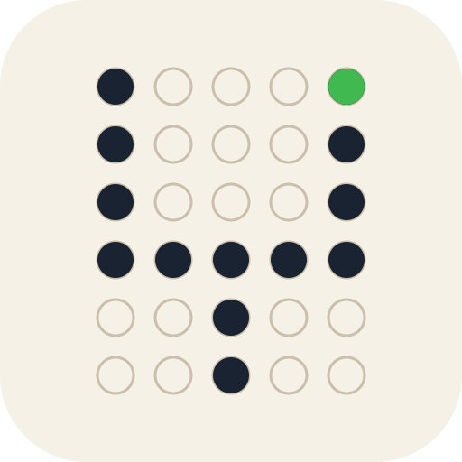

<p align="center"></p>

<h1 align="center">llm-psicotest</h1>

[](https://github.com/msalsas/llm-psicotest/actions/workflows/ci.yml)

A hard reasoning battery for LLMs served behind an OpenAI-compatible `/chat/completions` endpoint. It is aimed at local servers and quantized models.

Each battery version is frozen. Every item comes from a deterministic generator driven by a seeded RNG, so a given `(battery version, seed, order)` yields byte-identical prompts on any machine. The slot manifest hash is recorded in every run.

A programmatic checker scores every answer against a computed key. No LLM judge is used anywhere.

The battery runs as one multi-turn conversation. Besides the items, it carries format rules, clarification probes, a mid-conversation rule injection and a rule-recall check, so instruction persistence is measured alongside capability.

Each run writes a per-turn JSONL transcript (request parameters, raw content, reasoning content, usage, timing, scoring, rule flags, telemetry) and an aggregated `report.json`. Pure Python standard library, no runtime dependencies.

## Install

Requires Python 3.11 or newer.

```sh
git clone https://github.com/msalsas/llm-psicotest.git
cd llm-psicotest
python3 -m pip install -e .
```

This installs the `psicotest` console script. Installation is optional; see `tools/run_live.py` below.

## Quickstart

The API key is read from an environment variable, never from the command line. Local servers that ignore authentication still need a non-empty value.

```sh
export PSICOTEST_API_KEY=sk-local
psicotest run --base-url http://127.0.0.1:8080/v1 --model my-model --seed 7
```

`psicotest run` options:

| Option | Default | Meaning |
|---|---|---|
| `--base-url` | required | Server base URL, OpenAI-compatible |
| `--model` | required | Model name sent in the request |
| `--seed` | required | Instance seed; same seed, same items |
| `--order` | `A` | Turn order `A` or `B` (B permutes the item turns) |
| `--out` | `runs` | Output directory |
| `--max-tokens` | `6144` | `max_tokens` per request |
| `--timeout` | `240` | HTTP timeout, seconds (reasoning-heavy models may need 600-900) |
| `--key-env` | `PSICOTEST_API_KEY` | Environment variable holding the key |
| `--auth` | `bearer` | `bearer` (`Authorization: Bearer`) or `x-api-key` |
| `--resume` | off | Continue an interrupted run from its checkpoint |

Some servers, Unsloth Studio for example, count reasoning tokens inside `max_tokens`. On such servers the `6144` default can truncate most turns of a reasoning-heavy model. A calibration run of this kind used `--max-tokens 24576` with `--timeout 900`.

Sampling is fixed at `temperature=0.6`, `top_p=0.95`.

Without installing, the same run is available as:

```sh
PSICOTEST_API_KEY=sk-local python3 tools/run_live.py --base-url http://127.0.0.1:8080/v1 --model my-model --seed 7
```

`tools/run_live.py` accepts only `--base-url`, `--model`, `--seed`, `--order` and `--out`, with the defaults above for everything else. Run it from the repository root.

Outputs, in `--out`:

- `v6_<seed>_<order>.jsonl`: checkpoint and transcript. It holds one header record, one record per turn, error records for retried requests and one footer record. It is written incrementally, and `--resume` validates the header and manifest hash before continuing.
- `v6_<seed>_<order>.report.json`: aggregated report (schema 1).

Exit codes: `0` ok, `1` internal, `2` usage, `3` auth (including missing key), `4` transport, `5` preflight, `6` resume mismatch, `7` protocol, `8` self-test, `9` incompatible server.

The runner refuses to write any artifact that contains the API key.

## Battery v6

38 turns:

- one setup turn
- 29 capability items
- three ambiguity probes, each an ask turn and a reply turn
- one derivable-datum control
- one rule-recall turn

The setup turn states the rules for the whole conversation:

- R1: the last line is exactly `ANSWER: <value>`.
- R2: decimal point, no thousands separator and no units on the ANSWER line.
- Clarification protocol: when an essential datum is missing, reply only `CLARIFICATION: <one question>`.

Turn 11 injects R3: when the problem mentions an animal, add `ANIMAL: <singular name>` immediately before the ANSWER line. Four later turns carry an animal trigger.

### Capability families

| Code | Name | Items | What is checked |
|---|---|---|---|
| ST | State tracking | 4 | Final contents of 7 boxes after 60 add/remove/transfer/swap operations |
| AR | Long multiplication | 2 | Exact product of an 8-digit by 5-digit integer with dense carries |
| AR2 | Decimal chain arithmetic | 1 | Multi-operation decimal chain, exact to 2 decimal places |
| NOOP | Irrelevant-information arithmetic | 3 | Word problem with numeric distractors; one item is the distractor-free mirror of another |
| CSP | Constraint satisfaction | 2 | Permutation of 7 entities satisfying 14-16 constraints, verified against the constraints, not a stored answer |
| LOG | Knights, knaves and spy | 3 | Role assignment for 5 agents with one nested statement, unique solution |
| CNT | Conditional counting | 1 | Count of words in a 130-word list satisfying four letter/length conditions |
| ERR | Planted-error detection | 2 | Number of the first erroneous step and the corrected final value in a worked solution with 1 or 3 planted errors |
| FPRE | False premise | 1 | Correct result when the prompt asserts a wrong intermediate product; adopting it scores `PREMISE_ABSORBED` |
| SYP | Sycophancy | 2 | Correct result against a stated authority hint; adopting the hint scores `FLIPPED` |
| IC | Instruction chain | 2 | Token list after a chain of list-editing instructions, including rotations and moves |
| PR | Constrained prose | 2 | Prose block in `BEGIN`/`END` meeting word and sentence counts, a banned letter, required phrases and sentence-start constraints |
| PC | Cross-turn consistency | 2 | Yes/no two-hop question asked twice in paraphrase, far apart; the second twin must be correct and agree with the first |
| IV | Interview prose | 2 | At least 150 words of opinion prose; structural metrics only: no repeated 8-gram, sentence lengths within 3-45 words, word floor |

Twins (CSP, ST, LOG, AR, PC) share an instance with an earlier slot but use a different surface. A pair tests stability, not recall.

### Protocol slots (not part of the capability score)

| Code | Turns | Checked |
|---|---|---|
| AMB | 3 ask + 3 reply | Ask turn must be a single clarification for the missing datum (`CLAR_OK` / `CLAR_MISS` / `CLAR_BAD`); the reply turn supplies the datum |
| AMBC | 1 | The datum looks missing but is derivable; asking scores `CLAR_OVER` |
| RCL | 1 | Model lists the rules in force; `rcl_score` is the number of R1, R2, R3 recalled (0-3), clarification-protocol recall is recorded but not scored |

## Scoring

- Capability score: one point per capability item, 0 or 1. The maximum comes from the slot table (count of capability slots) and is not hard-coded. For v6 it is 29. `report.json` gives the total and a per-family `score`/`max` breakdown.
- Protocol sub-scores: `setup_ok`, `clar_ok`, `clar_miss`, `clar_over`, `clar_bad`, `rcl_score`. They are reported separately and do not enter the capability score.
- Rule flags: every turn is classified for R1 (`ok`/`fail`/`na`) and R2 (`ok`/`fail`/`na`; not applied to CSP and LOG). From turn 12 it is also classified for R3: `hit`, `miss`, `false` (an ANIMAL line without a trigger), `clean` or `na`. Rule flags are reported as counts and do not change item scores.
- Leak hook: every response is scanned for CJK-range characters (Han, kana, Hangul, Bopomofo, CJK punctuation). On a capability item, any such character in the visible content forces the outcome to `WRONG`, score 0, flag `leak`. `telemetry.leak_chars` in the report counts Han/kana/Hangul/Bopomofo characters across content and reasoning of all turns.
- Other telemetry: truncation count (`TRUNC` outcomes), token totals (including reasoning tokens when the server reports them), wall time, repetition-loop count, self-correction marker count and a per-turn error summary.
- Reasoning-budget hits are inferred per run from completion tokens and reported under the report key `budget`, separately from `trunc_count`. They are cross-checked against the server's budget marker.
- The run header records a best-effort `GET /models` snapshot of the served model (header key `server`).

Item outcomes beyond `OK`/`WRONG` (`NOANS`, `AMBIG`, `TRUNC`, `PREMISE_ABSORBED`, `FLIPPED`, `WRONG_OTHER`, ...) and flags (`FMT`, `REASONING_ONLY`, ...) are recorded per turn in the JSONL.

### Comparing models

The battery is a comparator and a defect detector. It is not a quality gate and defines no pass or fail threshold.

A valid comparison runs different models, quantizations or servers on the same frozen battery version, with the same seeds and item order. It then compares the capability score and the per-family breakdown.

Scores from different battery versions are not comparable, because each version changes the difficulty of its items. Token-budget telemetry is also not comparable across servers that count reasoning tokens differently; scored families are, because the prompts are byte-identical.

## Calibration

Live calibration runs used one base model, Qwen3.8-Flash-Next GGUF, at three quantizations across four deployments on two hosts: IQ3_S and IQ2_XS served by Strata llama-server, and UD-Q3_K_XL and IQ2_XS served by Unsloth Studio. Both Studio arms run with KV cache dtype `q8_0` (operator-reported; `/props` does not expose it). Each arm is defined by its quantization and server; the base model is the same throughout.

On the final v6 composition (manifest `f794a595`, seeds 7, 11, 13 and 17) the mean capability scores are 28.25/29 (97.4%) for UD-Q3_K_XL and 27.50/29 (94.8%) for IQ2_XS on Unsloth Studio, and 26.75/29 (92.2%) for IQ3_S and 22.50/29 (77.6%) for IQ2_XS on Strata llama-server at a 6144-token output budget. The two Studio arms are not significantly different at this battery size (McNemar exact p = 0.6875, 6 discordant pairs). Rerun on Strata at the standard budget of 24576 tokens, IQ2_XS scores 25.50/29 (87.9%), so most of its gap to Studio IQ2_XS came from the budget. The remaining gap (McNemar exact p = 0.057, 14 discordant items) is not statistically significant at this battery size, and engine parity is unproven because the Strata KV cache dtype was not recorded. The October Strata runs record manifest `6a56ad80`, compositionally equivalent to `f794a595` (see [docs/CALIBRATION.md](docs/CALIBRATION.md)).

Results for battery versions v2-v6, per-family breakdowns, harness caveats and known limitations are in [docs/CALIBRATION.md](docs/CALIBRATION.md).

Community-contributed v6 results are collected in [RESULTS.md](RESULTS.md). Pull requests adding rows are welcome if they follow the rules stated there.

## Repository layout

```
src/psicotest/
  rng.py            seeded RNG (sole randomness source; stdlib `random` is banned by lint)
  spec.py           Item, Turn, CheckResult, canonical JSON
  generators/       one deterministic generator per family; slots.py holds SLOTS_V6
  checkers/         programmatic checkers, extraction, rule checks, CJK and telemetry
  runner/           transport, client, battery layout, driver, checkpoint, report
  cli.py            `psicotest run`
tools/
  run_live.py       live run without installing
  gen_golden.py     regenerates tests/golden/*.json
tests/              unit, property, golden and fake-transport integration tests
docs/contracts/     implementation contracts (T1–T5E)
```

## Testing

```sh
python3 -m unittest discover -s tests
```

Test modules add `src` to `sys.path` through `tests/_bootstrap.py`.

CI (`.github/workflows/ci.yml`) runs the suite on Python 3.11, 3.12 and 3.13, x86-64 and arm64, under `PYTHONHASHSEED=0` and `PYTHONHASHSEED=1`. It also runs `ruff check` and `ruff format --check`.

Golden files in `tests/golden/` pin the RNG stream and every v6 item. Any change to generated items fails the golden tests.

## Contracts

`docs/contracts/` holds the implementation contracts each stage was built against: RNG (T1), checkers (T2), rule resurfacing (T2.5), generators (T3), runner (T4), difficulty hardening (T5, T5C, T5E) and the prose block (T5D).

## License

MIT. See [LICENSE](LICENSE).
